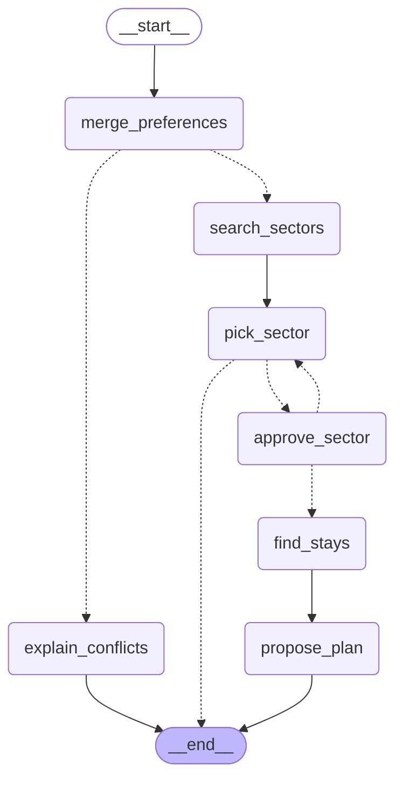

# 006: Stage 6.7, why a graph: sketch the trip-planner agent

**Status:** Ready
**Size:** S
**Mode:** delivery, no code: the deliverable is the sketch written into this ticket (see "Sketch" below).
**Raw request:** "Before code: sketch the actual steps a trip-planning agent needs: merge group prefs → search sectors → pick one → find stays → maybe ask the user something → propose a plan. Notice this isn't a straight line: there's a decision point and a place a human needs to weigh in."

## User story
As the learner, I want to sketch the trip planner's steps, decisions and human checkpoint
before writing any LangGraph code, so that I understand why a chain (a straight line)
isn't enough and a graph is.

## What exists today
The services that the planner's steps will reuse:
- Merge preferences: `merge_preferences(members)` → `MergeResult` with `filters`,
  `conflicts` and `common_ground` (`services/group_matching.py`).
- Search sectors: `search_for_group(db, members, mode, fit)` → `GroupSearchResponse`
  (`services/group_search.py`). It already handles strict and scored modes and "no
  members".
- Find stays: `find_stays_near(db, lat, lon, max_distance_km, stay_type=None)`, plus
  `airbnb_url()`, `booking_url()` and `next_saturday()` (`services/stays.py`).
- The 6.5 chain (ticket 003) is a straight line: every input goes through the same steps.

## Acceptance criteria
1. Given the sketch, when it's read, then it lists every step with what it reads and what
   it produces.
2. Given the sketch, then it marks at least one decision point (no common ground → a
   different path) and one place where a human must approve (the sector, before stays).
3. Given the sketch, then each step names the existing function it reuses, or says "new".
4. Given a chain from 6.5, then the sketch says in two or three sentences why a chain
   can't express this flow.

## Scope
**In:** the diagram and notes, in this file.
**Out:** any code. LangGraph isn't installed yet: that happens in ticket 007.

## Sketch
Ticket 011 compares the final graph against this sketch, name for name.


| Step | Reads | Produces | Reuses |
|---|---|---|---|
| `merge_preferences` | share code | members, merged filters or conflicts | `merge_preferences()` |
| `explain_conflicts` | conflicts | the "no plan" message | **new** (only joins the existing conflict strings) |
| `search_sectors` | members | candidate sectors | `search_for_group(db, members, "strict", "overlap")` |
| `pick_sector` | candidates, rejections | the chosen sector | **new** (a rule: the first candidate not yet rejected) |
| `approve_sector` (human) | the chosen sector | approved or rejected, plus a reason | **new** |
| `find_stays` | the chosen sector | nearby stays | `find_stays_near()` |
| `propose_plan` | the sector, stays, dates, guests | the final plan | `airbnb_url()`, `booking_url()`, `next_saturday()` |

Note: in strict mode `search_for_group()` runs `merge_preferences()` again internally.
Merging stays its own step because the graph needs the result before searching, to branch.

**Decision points**
- Common ground? No leads to `explain_conflicts` and the run ends; yes leads to `search_sectors`.
- A sector left to propose? No ends the run with no plan; yes goes on to `approve_sector`.
- Approved? Yes goes on to `find_stays`; no goes back to `pick_sector`, which skips rejected sectors.

**Human checkpoint**
- `approve_sector`: the group says yes or no to the chosen sector, before any stays are looked up.

**Why a chain can't express this**
A chain is a fixed pipe: every input runs every step once, in order. This flow skips steps
(no common ground), loops back (a rejected sector), and has to stop and wait for a person
before continuing, possibly much later. All of that needs state shared between steps plus
edges chosen at run time, which is what a graph provides.

## Built vs sketched

Delivered graph (`build_trip_planner().get_graph().draw_mermaid()`):



**Matched**
- All seven nodes kept the sketch's names: `merge_preferences`, `explain_conflicts`, `search_sectors`, `pick_sector`, `approve_sector`, `find_stays`, `propose_plan`.
- All three decision points became conditional edges: common ground (`route_after_merge`), a sector left to propose (`route_after_pick`) and approved or rejected (`route_after_approval`), with the same targets as the sketch.
- The human checkpoint is still `approve_sector`, before any stays are looked up.
- A rejection still loops back to `pick_sector`, which skips rejected sectors.
- `search_sectors` only stores the candidates and `pick_sector` chooses, as sketched, so a rejection loops back without searching again. (The 6.9 build used the top result as the chosen sector until 6.11 added `pick_sector`.)
- Strict search merges the preferences again internally (`search_for_group` calls `merge_preferences()`), as the sketch's note said. Merging stays its own node because the graph needs the result before searching, to branch.

**Changed, and why**
- The pause is inside `approve_sector` (`interrupt()`), not a separate wait. The question goes out and the answer comes back as a return value, so the approve/reject branch stays inside the graph instead of being split between the caller and the graph.
- Members are copied into the state as plain dicts. A paused run does not change if someone edits the group meanwhile, and the checkpointer can store them.
- After three rejections (`MAX_PROPOSALS`) `pick_sector` ends the run with a message instead of asking again. The group should change its preferences, not keep clicking no.
- An empty strict search leaves by the same exit: `search_sectors` stores the message and `pick_sector` ends the run. The sketch had no "no sectors found" path; one exit for "nothing to propose" keeps the graph smaller.
- The database session lives in the runtime context (`PlannerContext`), not the state. A session is not plain data, so the checkpointer cannot store it. It is passed again on every call, including a resume.
- A group with no members goes to `explain_conflicts` with "The group has no members yet." `merge_preferences([])` would mean "no limits", but there is nobody to plan for.
- An unknown share code raises `ValueError` instead of taking a route: bad input is an error, not "no result".
- The `merge_preferences` node also loads the group (`find_group`) and sets `guests` to the number of members when the caller gave none. Its function is called `merge_group_preferences` so it does not clash with the service it calls.
- `find_stays` keeps at most five stays within 10 km: a plan is a shortlist, and 10 km is the stays endpoint's default.
- The sketch's decision diamonds are not nodes. They became the `route_after_*` functions, drawn as unlabelled dotted edges, because in LangGraph a decision is a routing function, not a step.

**Traces** (from `run_planner()`, the function the script runs, with scripted answers instead of the terminal prompt; shortened)

With common ground and one rejection (Planner demo):
```
merge_preferences: members, guests, filters, conflicts
search_sectors: candidates
pick_sector: chosen_sector, approved
approve_sector: rejected: too close to the city      (Collbató)
pick_sector: chosen_sector, approved
approve_sector: approved                              (Can Marges)
find_stays: stays
propose_plan: plan, message
```

Without common ground (Checkpoint demo), no search and no prompt:
```
merge_preferences: members, guests, filters, conflicts
explain_conflicts: message
No common ground, so no search: No grade everyone climbs: Marc wants 7a or harder, but Ana wants 6b or easier.
```

## Notes for the tech lead
- A Mermaid `flowchart` in this file is enough, since VS Code previews it.
