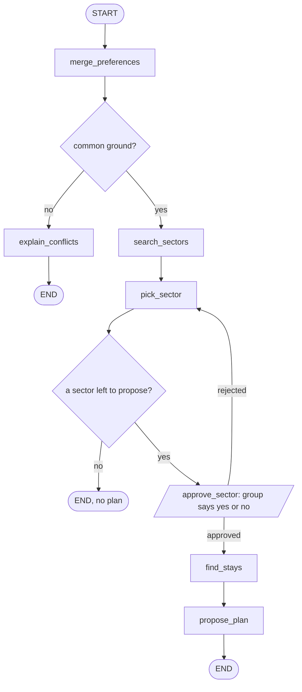

# 006: Stage 6.7, why a graph: sketch the trip-planner agent

**Status:** Ready
**Size:** S
**Mode:** delivery, no code: the deliverable is the sketch written into this ticket (see "Sketch" below).
**Raw request:** "Before code: sketch the actual steps a trip-planning agent needs: merge group prefs → search sectors → pick one → find stays → maybe ask the user something → propose a plan. Notice this isn't a straight line: there's a decision point and a place a human needs to weigh in."

## User story
As the learner, I want to sketch the trip planner's steps, decisions and human checkpoint
before writing any LangGraph code, so that I understand why a chain (a straight line)
isn't enough and a graph is.

## What exists today
The services that the planner's steps will reuse:
- Merge preferences: `merge_preferences(members)` → `MergeResult` with `filters`,
  `conflicts` and `common_ground` (`services/group_matching.py`).
- Search sectors: `search_for_group(db, members, mode, fit)` → `GroupSearchResponse`
  (`services/group_search.py`). It already handles strict and scored modes and "no
  members".
- Find stays: `find_stays_near(db, lat, lon, max_distance_km, stay_type=None)`, plus
  `airbnb_url()`, `booking_url()` and `next_saturday()` (`services/stays.py`).
- The 6.5 chain (ticket 003) is a straight line: every input goes through the same steps.

## Acceptance criteria
1. Given the sketch, when it's read, then it lists every step with what it reads and what
   it produces.
2. Given the sketch, then it marks at least one decision point (no common ground → a
   different path) and one place where a human must approve (the sector, before stays).
3. Given the sketch, then each step names the existing function it reuses, or says "new".
4. Given a chain from 6.5, then the sketch says in two or three sentences why a chain
   can't express this flow.

## Scope
**In:** the diagram and notes, in this file.
**Out:** any code. LangGraph isn't installed yet: that happens in ticket 007.

## Sketch
Ticket 011 compares the final graph against this sketch, name for name.

| Step | Reads | Produces | Reuses |
|---|---|---|---|
| `merge_preferences` | share code | members, merged filters or conflicts | `merge_preferences()` |
| `explain_conflicts` | conflicts | the "no plan" message | **new** (only joins the existing conflict strings) |
| `search_sectors` | members | candidate sectors | `search_for_group(db, members, "strict", "overlap")` |
| `pick_sector` | candidates, rejections | the chosen sector | **new** (a rule: the first candidate not yet rejected) |
| `approve_sector` (human) | the chosen sector | approved or rejected, plus a reason | **new** |
| `find_stays` | the chosen sector | nearby stays | `find_stays_near()` |
| `propose_plan` | the sector, stays, dates, guests | the final plan | `airbnb_url()`, `booking_url()`, `next_saturday()` |

Note: in strict mode `search_for_group()` runs `merge_preferences()` again internally.
Merging stays its own step because the graph needs the result before searching, to branch.

**Decision points**
- Common ground? No leads to `explain_conflicts` and the run ends; yes leads to `search_sectors`.
- A sector left to propose? No ends the run with no plan; yes goes on to `approve_sector`.
- Approved? Yes goes on to `find_stays`; no goes back to `pick_sector`, which skips rejected sectors.

**Human checkpoint**
- `approve_sector`: the group says yes or no to the chosen sector, before any stays are looked up.

**Why a chain can't express this**
A chain is a fixed pipe: every input runs every step once, in order. This flow skips steps
(no common ground), loops back (a rejected sector), and has to stop and wait for a person
before continuing, possibly much later. All of that needs state shared between steps plus
edges chosen at run time, which is what a graph provides.

## Notes for the tech lead
- A Mermaid `flowchart` in this file is enough, since VS Code previews it.
